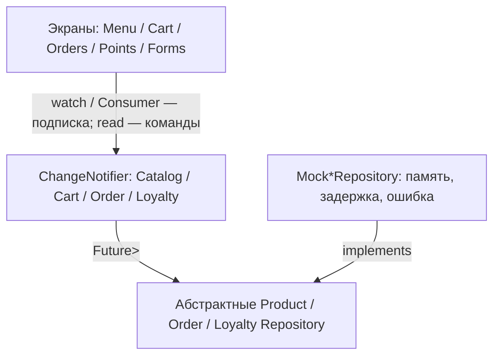

# Лабораторная №4 — CoffeeClub (T20)

Проект продолжает L2 и L3 в том же репозитории. В L4 используются `provider`,
`ChangeNotifier`, `Future<Result<T>>` и mock-репозитории. Это **не** подключение
к настоящему серверу: данные живут в оперативной памяти до закрытия приложения.

## Архитектура



- **UI**: только отображает состояние и отправляет действия, не импортирует `mock_data.dart`.
- **Models**: read-only коллекции, мутации через методы и `notifyListeners()`.
- **SessionModel**: локальная сессия L3 между входом и профилем, без сетевой авторизации.
- **Repository interface**: CRUD-контракт без зависимости от источника.
- **Mock implementation**: исходные данные в памяти, `Future.delayed` (850 мс), контролируемый отказ.
- **L5**: добавляются API-реализации интерфейсов; в `main.dart` меняются только создаваемые репозитории. Экраны и модели остаются без изменений; демонстрационный переключатель сбоя удаляется.

## Запуск и проверка

В терминале Android Studio в папке проекта:

```bash
flutter pub get
dart format lib test
flutter analyze
flutter test
flutter run
```

1. Войти с любым корректным email и паролем длиной не менее 6 символов.
2. На экране меню дождаться загрузки. Открыть Cappuccino → выбрать размер → добавить в корзину; число на badge увеличится.
3. В корзине изменить количество, свайпнуть позицию влево, снова добавить товар.
4. В корзине выбрать использование баллов, перейти к оформлению, заполнить имя и телефон. После подтверждения заказ появляется во вкладке «Заказы», а начисления и списания — во вкладке «Баллы».
5. На экране «Меню» нажать «Новый товар», проверить валидацию, сохранить. Отредактировать или удалить товар в деталях; список и корзина обновятся.
6. Во вкладке «Профиль» включить «Симулировать сбой сети». Вернуться в меню и нажать иконку обновления: после spinner появится ошибка с «Повторить». Выключить сбой в профиле и нажать «Повторить»: список восстановится.
7. С включённым сбоем попробовать оформить заказ или сохранить товар: данные формы сохраняются, появляется SnackBar с ошибкой.

## Скриншоты для PDF-отчёта

- Титульный лист: T20 CoffeeClub — программа лояльности кофейни.
- Собственная диаграмма выше, пояснения слоёв и замены mock на L5.
- Фрагменты `product_repository.dart`, `mock_product_repository.dart` (`fetchAll`) и `catalog_model.dart` (`load`).
- Три состояния каталога: spinner → данные → ошибка/кнопка Retry.
- Мутация из детализации: badge до/после и содержимое корзины.
- Форма оформления до submit → новый заказ во вкладке истории; по возможности — новые баллы.
- `git log --oneline` (полностью, начиная с L2).

На защите показывайте каждый переход **в живом приложении**. Чистые mock-данные
не переживают перезапуск — это ожидаемое ограничение L4, персистентность будет в L6.
